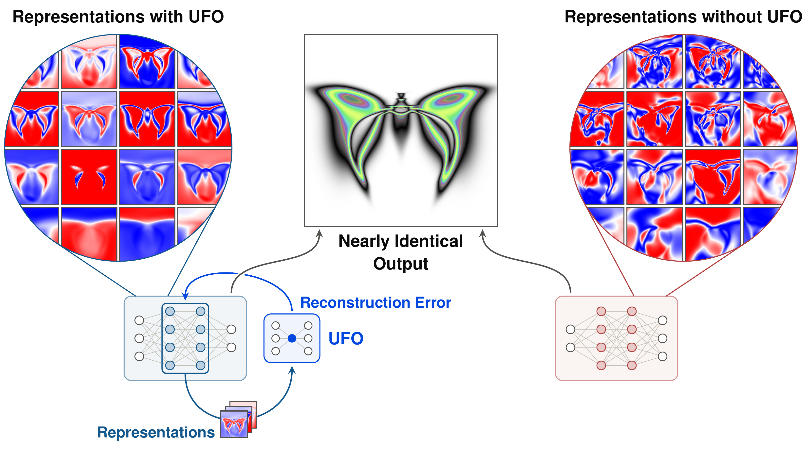

# Are UFOs Real? Introducing Unified Factored Organizers

**Thomas X. Sheppard, Alon Albalak, Joel Lehman, Kenneth O. Stanley**

[Lila Sciences](https://www.lila.ai)

Correspondence: [tsheppard@lila.ai](mailto:tsheppard@lila.ai)



## Abstract

Implicit in much research in deep learning is the assumption that if a neural network achieves low loss, then it must have learned a good representation of its training data. Recent work by [Kumar et al. (2025)](https://arxiv.org/abs/2505.11581) questions this assumption, arguing that neural networks trained with conventional gradient descent achieve low loss despite learning *fractured entangled representations* (FER), leaving related concepts disconnected and unrelated concepts entangled inappropriately. Kumar et al. (2025) further show that dramatically better representations are possible: a network evolved through an open-ended, human-in-the-loop process learned *unified factored representations* (UFR) that capture the regularities of the domain far better than a counterpart with nearly identical outputs trained with conventional gradient descent. Inspired by UFR, this paper introduces *unified factored organizers* (UFOs), neural networks that are specially trained to model regularities in the representations of other neural networks. A neural network can then be trained both to achieve low loss on its task objective and to align its representations with the model learned by the UFO. Neural networks trained with UFOs are shown to learn qualitatively superior representations in an image-regression domain where representations are easily interpretable. To provide quantitative evidence for the impact of UFOs on representation learning, a transformer is trained with and without UFO regularization to grok a modular arithmetic problem set. When UFOs are combined with weight decay, UFOs can reduce the number of transformer training steps needed to grok by more than 10× relative to a baseline regularized with weight decay alone. Without weight decay, UFOs can reduce the number of transformer training steps needed to grok by more than 100× relative to an unregularized baseline. If UFOs are real, they suggest a new paradigm where loss functions themselves are trained to learn an effective model of good representation.

## Repository Summary

This companion repository recreates the grokking modular division experiments shown in *Are UFOs Real? Introducing Unified Factored Organizers*. A transformer is trained with UFO regularization both to achieve low task loss on division modulo 97 and to make its internal representations compressible by an auxiliary UFO autoencoder. 

## Table of Contents

- [Installation](#installation)
- [Config](#config)
- [Intercomponent and Intracomponent UFOs](#intercomponent-and-intracomponent-ufos)
- [Data](#data)
- [Transformer Model & Training](#transformer-model--training)
- [Selective UFO Updates](#selective-ufo-updates)
- [Reproducibility](#reproducibility)
- [Treatment Table](#treatment-table)
- [License](#license)

## Installation

From the `are-ufos-real` directory, install the required dependencies with:

```bash
uv sync
```

## Config

`ufo/config.py` defines the experimental setup: modular-division data, transformer architecture and training hyperparameters, UFO autoencoder architecture and training hyperparameters, UFO regularization schedule, selectivity schedules, weight-decay conditions, evaluation criteria, training budgets, and seeds. It also provides the `ExperimentConfig` used to represent each experiment. `ufo/matrix.py` defines all 144 experiment configurations.

## Intercomponent and Intracomponent UFOs

We test two types of UFO regularization: *intracomponent* and *intercomponent*. A *component* refers to either a hidden node or an attention edge, where an *attention edge* describes the query-key connection between two fixed sequence positions in a given attention head. An intracomponent representation captures the activations or attention weights *within* one component across all training examples in a batch. An intercomponent representation instead captures a layer's activations or attention weights *across* components for a single training example. Both intracomponent and intercomponent UFOs are used to regularize either MLP hidden node activations or attention weights and are intended to encourage the transformer to solve its task with regular representations. 

Representations are normalized, so the transformer cannot reduce UFO reconstruction error by simply shrinking its activations. Instead, it must change their shape rather than just their scale.

The intracomponent and intercomponent UFO autoencoders, representation extraction, and UFO updates are defined in `ufo/intracomponent_ufo.py` and `ufo/intercomponent_ufo.py`.

## Data

`ufo/data.py` generates data and initializes tokens for a division modulo 97 training task. For ease of extensibility to other tasks, it also includes tokens for the algorithmic datasets shown in OpenAI's *Grokking: Generalization Beyond Overfitting on Small Algorithmic Datasets* ([Power et al., 2022](https://arxiv.org/abs/2201.02177)).

## Transformer Model & Training

`ufo/model.py` defines the transformer and `ufo/training.py` implements UFO-regularized training on division modulo 97. 

Each training step consists of two updates. In a primary update, the transformer is trained to minimize its task loss as well as an auxiliary loss for how well the UFO can reconstruct its representations. This auxiliary loss is weighted by a UFO regularization schedule λ(t). λ(t) is warmed up from zero to its steady-state value between steps 250 and 500, so the transformer can begin to fit the training data with little UFO regularization pressure. During the transformer update, the UFO parameters are held fixed. 

The UFO is then updated on select representations from the transformer, and a stop-gradient is placed on these representations so that the transformer is not updated a second time. 

## Selective UFO Updates

If the UFO were updated to better reconstruct *all* of the transformer's representations, it would risk accommodating the transformer's least regular representations and training away the regularization pressure it is intended to impose. In an attempt to avoid this, UFOs are updated *selectively*. Training examples whose representations have high reconstruction error are not used to update the UFO, so the transformer must instead adjust those representations to become compressible by the UFO. A selectivity schedule s(t) sets the fraction of training examples used in each UFO update. Helper functions for updating UFOs selectively are in `ufo/selectivity.py`.

## Reproducibility

`ufo/reproduce.py` provides the command-line interface for listing experiments, running one by index, running the full matrix, and summarizing results.

```bash
uv run ufo-reproduce list
uv run ufo-reproduce run --index 1
uv run ufo-reproduce summarize
```

Each experiment writes a CSV to `results/`. `ufo/results.py` combines these files into `results/summary.csv`, including grok rates (`grokking_rate`) and Kaplan–Meier median grok steps (`km_median`). `reference_results.csv` contains the outcome of each of the 144 runs behind the grokking results tables in the paper. The reference runs were produced on NVIDIA H100 80GB HBM3 GPUs using CUDA 13.0 and PyTorch 2.13.0+cu130. Exact seed-level grokking steps may vary across hardware and software environments as small floating-point differences in CUDA kernels and operation ordering can compound over long training trajectories.

The full matrix can be run with `uv run ufo-reproduce run --all --confirm-all`.

## Treatment Table

For each treatment in the table below, 8 seeds are tested. Each seed varies the transformer initialization, the UFO initialization, and the minibatch order.


| Weight Decay | UFO Type       | Regularization Target       | UFO Update Strategy | Treatment Type       |
| ------------ | -------------- | --------------------------- | ------------------- | -------------------- |
| WD = 0.03    | Intercomponent | MLP Hidden Node Activations | Selective           | Primary              |
| WD = 0.03    | Intercomponent | Attention Weights           | Selective           | Primary              |
| WD = 0.03    | Intercomponent | MLP Hidden Node Activations | Fixed               | Experimental Control |
| WD = 0.03    | Intercomponent | Attention Weights           | Fixed               | Experimental Control |
| WD = 0.03    | Intercomponent | MLP Hidden Node Activations | Non-Selective       | Experimental Control |
| WD = 0.03    | Intercomponent | Attention Weights           | Non-Selective       | Experimental Control |
| WD = 0.03    | Intracomponent | MLP Hidden Node Activations | Selective           | Primary              |
| WD = 0.03    | Intracomponent | Attention Weights           | Selective           | Primary              |
| WD = 0.03    | Intracomponent | MLP Hidden Node Activations | Fixed               | Experimental Control |
| WD = 0.03    | Intracomponent | Attention Weights           | Fixed               | Experimental Control |
| WD = 0.03    | Intracomponent | MLP Hidden Node Activations | Non-Selective       | Experimental Control |
| WD = 0.03    | Intracomponent | Attention Weights           | Non-Selective       | Experimental Control |
| WD = 0.03    | None           | None                        | No UFO              | WD only              |
| None         | Intercomponent | MLP Hidden Node Activations | Selective           | Primary              |
| None         | Intercomponent | Attention Weights           | Selective           | Primary              |
| None         | Intracomponent | MLP Hidden Node Activations | Selective           | Primary              |
| None         | Intracomponent | Attention Weights           | Selective           | Primary              |
| None         | None           | None                        | No UFO              | Unregularized        |


In *Fixed* controls, the UFO is held at its random initialization throughout training. In *Non-Selective* controls, the UFO is updated on all representations (i.e., s(t) = 1). In result files and `reference_results.csv`, treatments appear as `scheduled` (Selective), `updates0` (Fixed), `updates1` (Non-Selective), and `baseline` (WD only or Unregularized, depending on weight decay). Baseline result files use `plain` in their names (e.g., `seed01-plain-wd0p03.csv`).

## License

This project is licensed under the [Apache License 2.0](./LICENSE).

The UFO method is original to this work. The decoder-only transformer in `ufo/model.py` and the token vocabulary and modular-arithmetic dataset generation in `ufo/data.py` contain code adapted from [openai/grok](https://github.com/openai/grok), used under the MIT License (see [Third-Party Notices](./THIRD_PARTY_NOTICES.md)).